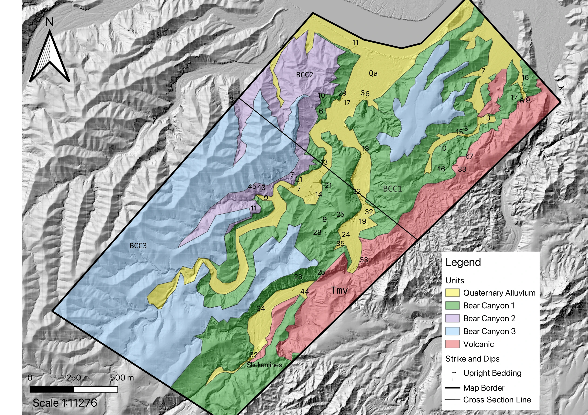
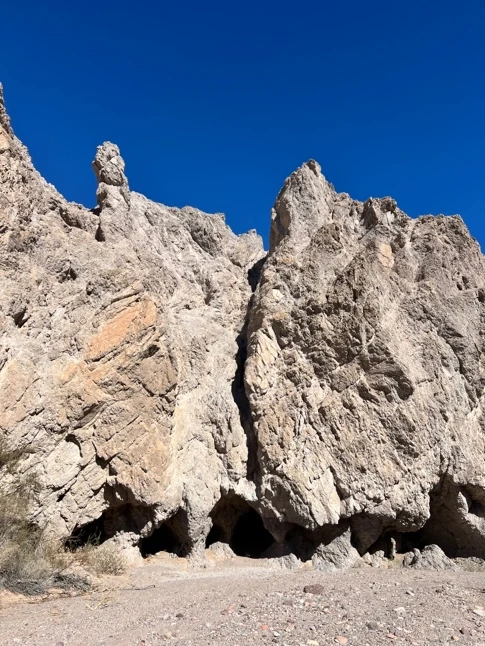
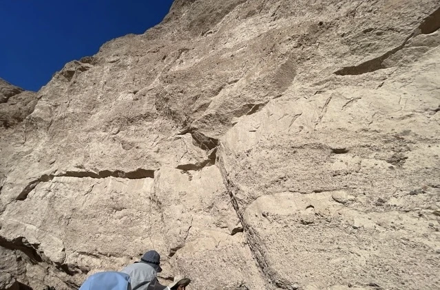
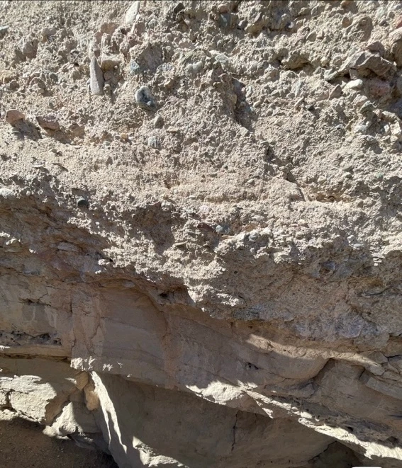
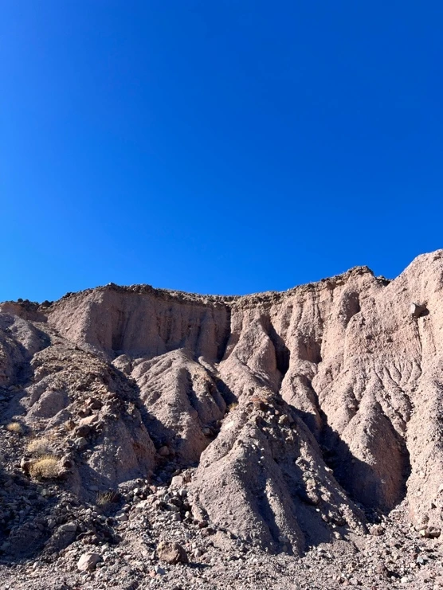
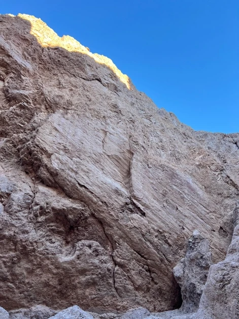
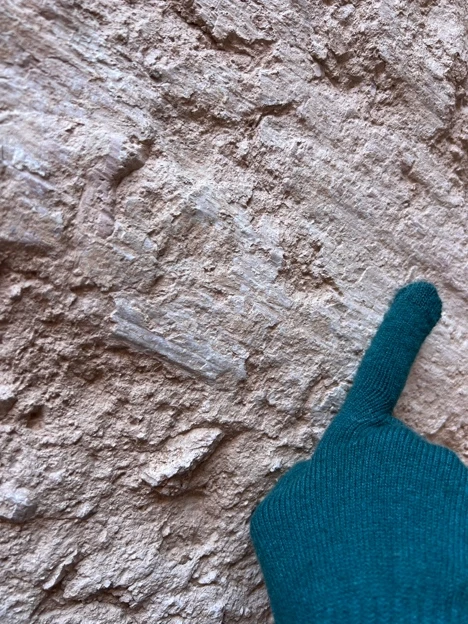

A canyon is more than a gap in the landscape. Its walls expose a sequence of events: volcanic eruptions, the movement of sediment, deformation, and erosion. In Bear Canyon, those events can be read in the rocks themselves—and in the boundaries between them.

This field study examines the Bear Canyon Conglomerate in southeastern California. Using StraboSpot, printed maps, and a field notebook, I recorded rock types, bedding, contacts, and evidence of fault movement. The resulting map brings those observations together across an area of washes, steep outcrops, and exposures near the Colorado River.

Five units organize the story: an older volcanic unit, three conglomerate units, and younger alluvium. Their differences in texture, composition, and orientation provide a way to reconstruct how the landscape changed.

## The field map

Mapping connects individual outcrops to the wider landscape. On this map, volcanic rocks occupy much of the southeastern margin, while the conglomerate units extend across the canyon. Alluvium follows many of the washes and covers parts of the older bedrock.

*Figure 1. The project’s geological map, including mapped contacts, strike and dip measurements, and a cross-section line. Select the map to enlarge it.*

The contacts are particularly revealing. Unit 2 narrows and locally disappears between Units 1 and 3, allowing the youngest conglomerate to lie directly against the oldest. In the northeast, volcanic outcrops among Unit 1 and alluvium suggest an irregular older surface. A former valley is one possible interpretation of that geometry.

## Five units

The sequence below summarizes the units described in the field report, from youngest to oldest. The colors follow the map; the rows do not represent measured thicknesses.

Youngest → oldestMap key

Qa<strong>Quaternary alluvium</strong>Loose sediment reworked from the surrounding rocks.

BCC3<strong>Conglomerate 3</strong>Dark, locally near-horizontal beds; recycled conglomerate clasts.

BCC2<strong>Conglomerate 2</strong>Sandier beds and siltstone; a more varied clast population.

BCC1<strong>Conglomerate 1</strong>Coarse, poorly sorted beds with volcanic clasts.

Tmv<strong>Volcanic rocks</strong>Ash-fall and ash-flow deposits beneath the conglomerates.

### An older volcanic landscape

The oldest mapped unit consists of volcanic deposits described in the original report as approximately 23 million years old. Pale white to tan exposures are fine grained, angular, and rough, with resistant outcrops forming jagged peaks. Other surfaces weather brown and are less immediately recognizable.

Ash-flow deposits include ignimbrite, a rock formed from hot volcanic material. Flattened pumice fragments, known as *fiamme*, are an important texture to look for. The volcanic unit also supplied the rock fragments that later became part of the conglomerates.

### Unit 1 · A local volcanic source

The first conglomerate is pinkish tan and poorly sorted: fine sand occurs alongside much larger clasts, including boulders. Its discontinuous beds are commonly about 1–3 feet thick, with thinner intervals of roughly 6–12 inches. Both normal and inverse grading were noted.

The clasts identified in this unit were subangular volcanic fragments. Their composition connects the deposit to the older volcanic landscape, while the mixture of grain sizes is consistent with episodes of sediment transport capable of moving coarse material. Bedding dips of about 30° were described in the report; the map preserves the variation among individual measurements.

*Figures 2–3. The resistant volcanic outcrops and the coarse, discontinuous bedding of Unit 1. Photographs from the field report.*

### Unit 2 · A changing sediment supply

Unit 2 is generally tan and contains pebble- to cobble-sized clasts in sandier beds, with intervals of siltstone. The clasts range from subrounded to angular. Volcanic fragments occur alongside schist and granitic material, recording a broader range of source rocks than was identified in Unit 1.

The report describes a gentler bedding inclination of approximately 10°. The contrast with Unit 1 marks an angular unconformity: a boundary across which the orientation of the beds changes. Unit 2 also thins laterally, making its distribution an important part of the map interpretation.

### Unit 3 · A record of recycling

The youngest conglomerate forms darker, relatively flat-lying exposures at the top of the canyon. It contains pebble- to cobble-sized clasts of volcanic and metamorphic rocks, as well as fragments of older conglomerate.

Those recycled conglomerate clasts are especially useful evidence. Older sediment had already become rock, been exposed, and eroded before its fragments were incorporated into this younger deposit. Unit 3 overlies both Units 1 and 2, preserving another break in the depositional record.

*Figures 4–5. A finer-grained interval in Unit 2 and the darker upper exposures of Unit 3.*

### Alluvium · The landscape today

The youngest mapped material is loose alluvium in washes and on parts of the surrounding terrain. It includes sediment derived from the older units, ranging from pebbles to boulders and from angular to subrounded clasts. Erosion and transport continue to redistribute that material, extending the geological story into the present.

## Evidence of movement

The canyon preserves movement at more than one scale. Slickenlines—linear marks on surfaces where rock has slipped—were recorded on both small surfaces and large outcrop faces in Unit 1. The field report also identifies exposures interpreted as minor normal faults.

*Figures 6–7. Slickenlines at outcrop and hand-sample scales. These surfaces preserve evidence of relative movement.*

The angular unconformities provide another line of evidence. Older beds meet younger deposits at different inclinations. Together with changes in sediment composition and the local absence of Unit 2, these relationships indicate a history interrupted by changes in deposition, deformation, and erosion.

**Observation and interpretation.** Bedding angles and slip surfaces are field observations. The timing and regional cause of deformation require additional evidence. The approximate dips described here summarize the report’s local observations; they are not uniform orientations for every exposure.

Regional work provides a wider context. [Ricketts and colleagues (2011)](https://doi.org/10.2110/jsr.2011.66) interpret the Bear Canyon succession in terms of episodic growth of the Chocolate Mountains anticlinorium, a broad folded structure. Their study documents shortening and later faulting following an earlier period of extension. That history is more complex than attributing every local structure directly to extension along the San Andreas system.

## Reading the history

The field relationships support a relative sequence. Volcanic deposits established an older substrate. Erosion supplied volcanic debris to Unit 1. Later deposits incorporated a wider range of rock types, while breaks in the sequence and changes in bedding orientation record an evolving landscape. By the time Unit 3 accumulated, fragments of older conglomerate were available to be recycled.

Regional basement rocks discussed in the report include the Orocopia Schist, orthogneiss, and the Winterhaven Formation. Their presence provides context for the nonvolcanic clasts, although assigning an individual fragment to a specific source would require closer comparison.

The sequence is clearest as a relative history, rather than a precise timetable. The field report does not establish absolute ages for each conglomerate unit, and the present dip of a bed alone does not establish its original depositional slope or the former level of the Colorado River.

Continued erosion then cut through the succession, exposing the contacts and structures visible today. The canyon’s value as a field site lies in this connection between scales: a fragment reveals a source, a bed records transport, a contact marks a change, and a map brings those clues into a landscape history.

## Sources

This essay is adapted from my *Project 3 Report: Bear Canyon* and its accompanying geological map. The field photographs and local observations come from that project. Regional context is identified separately above.

**Reference** 
Ricketts, J. W., Girty, G. H., Sainsbury, J. S., Muela, K. K., Sutton, L. A., Biggs, M. A., & Voyles, E. M. (2011). Episodic growth of the Chocolate Mountains anticlinorium recorded by the Neogene Bear Canyon Conglomerate, southeastern California, U.S.A. *Journal of Sedimentary Research, 81*(12), 859–873. [doi:10.2110/jsr.2011.66](https://doi.org/10.2110/jsr.2011.66).

