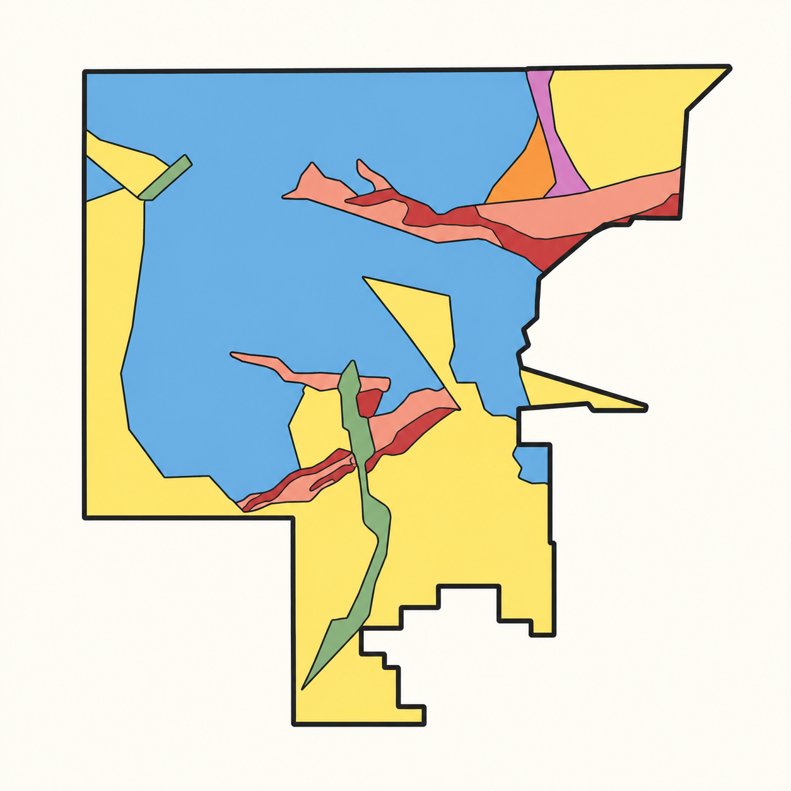

At the beginning of the semester, creating a geological map for a local conservation organization felt like an unfamiliar challenge. By the end, the task had become a way to connect what we learned in the field with the people who live alongside the Franklin Mountains. Our map of Knapp Land Nature Preserve was designed to make that nearby geological history easier to see and understand.

The project brought together field mapping, teamwork, and community engagement. Working toward a deliverable for The Frontera Land Alliance, our group traced rock units across ridges and arroyos, recorded their orientations, and assembled those observations into a map for educational use. The result describes both the older bedrock and the younger materials that shape the preserve’s surface.

## The field map

The final map identifies seven geological units, together with faults, bedding measurements, trails, preserve boundaries, and areas modified by people. Lanoria Quartzite occupies much of the mapped bedrock terrain. Red Bluff Granite and narrow diabase bodies add evidence of intrusive activity, while alluvium, terraces, talus, and fan deposits record erosion and sediment movement.

*Figure 1. The completed geological map, credited to UTEP’s Department of Earth, Environmental and Resource Sciences, Fall 2024 Community Engagement Class. Select the image to enlarge it and read the unit descriptions.*

The map’s symbols are part of its explanation. Strike and dip measurements describe the orientation of bedding. Dashed contacts mark boundaries that are concealed or inferred. Normal faults are shown with a mark on the down-dropped side. These distinctions help a reader separate mapped observations from interpretations made between exposures.

## From field notes to a shared map

Our group visited the preserve three times. The first visit was a reconnaissance walk: an opportunity to become familiar with the terrain and identify useful areas of study. Later visits followed a main ridge and an arroyo, allowing us to compare exposures across different parts of the preserve.

We worked with compasses, printed Google Earth imagery, GPS, map boards, and StraboSpot. On the printed maps, we marked the boundaries of units we could recognize as we hiked. Strike and dip measurements helped connect observations across separate outcrops, while the imagery provided a broader view of the land between them.

Much of the work involved returning to the same question: does the rock on one hillside belong to the same unit as the exposure across the drainage? Following units through the landscape helped turn isolated observations into a coherent interpretation. The Lanoria and Red Bluff units were recurring features on our visits, and dark intrusive rock cut the Lanoria at several locations.

*Figure 2. A simplified, AI-assisted redraw of a group member’s early working map. It retains the broad layout of the initial interpretation; boundaries are schematic. See Figure 1 for the completed geological map.*

Producing the final version required more than drawing contacts. The map needed to communicate clearly to people who had not joined the field trips. Unit descriptions, recognizable landmarks, consistent symbols, and the preserve boundary made the geological information easier to place in context.

## Seven mapped units

The final legend distinguishes three older bedrock units and four Quaternary surface deposits. The summary below follows the map’s unit categories and colors; it is a map key rather than a column of measured thicknesses.

Seven mapped unitsMap key

Qal<strong>Alluvium</strong>Loose sediment in modern ephemeral stream channels.

Qte<strong>Terraces</strong>Older stream deposits above active depositional surfaces.

Qta<strong>Talus</strong>Angular rock fragments accumulated below steep slopes.

Qf<strong>Fan deposits</strong>Older, poorly sorted deposits cut by younger drainage channels.

Yd<strong>Diabase</strong>Dark intrusive rock, including narrow sills and dikes.

Yrb<strong>Red Bluff Granite</strong>Quartz- and feldspar-rich granite, approximately 1.1 billion years old.

Yl<strong>Lanoria Quartzite</strong>Resistant bedded quartzite that forms prominent ridges.

### Bedrock beneath the preserve

Lanoria Quartzite is a prominent ridge-forming unit. The final map describes pale yellow to white quartzite, commonly stained orange or red along bedding and fractures by iron oxides. Beds are generally about 0.5–2 metres thick. Finer-grained intervals and minor siltstone between the more resistant quartzite members produce less prominent exposures.

Red Bluff Granite is a medium- to coarse-grained intrusive rock composed mainly of quartz and alkali feldspar, with smaller amounts of biotite and hornblende. The map notes that it is commonly altered and readily weathered within the study area. Its approximately 1.1-billion-year age places it within a much older episode of magmatism. Regional research by [Shannon and colleagues (1997)](https://doi.org/10.1093/petroj/38.10.1279) describes the Red Bluff suite as having intruded an older Proterozoic sedimentary succession.

Diabase provides another record of intrusion. The map describes dark gray to green rock, commonly occurring as sills about 1–4 metres thick. During the project, we also noted a basaltic dike cutting the Lanoria in several places. Where an intrusion cuts an existing rock unit, that relationship establishes that the host rock was present first.

### The younger surface

The Quaternary deposits tell a different part of the story. Modern alluvium occupies channels where ephemeral streams transport loose sediment. Terraces preserve earlier stream deposits, described in the map legend as commonly standing about 1–2 metres above active depositional surfaces. Talus collects below cliffs and steep slopes as angular fragments, including boulders.

Older fan deposits cover parts of the hillsides and have been incised by younger drainage channels. The map describes poorly sorted pebble- to cobble-sized material, with smaller amounts of sandstone and siltstone, and interprets much of it as the product of high-energy debris flows. Together, these deposits show how rock eroded from the mountains becomes part of the landscape below.

## Faults, arroyos, and altered ground

The preserve records both geological processes and human modification. The final map shows the East Franklin Mountains Fault along its eastern side and another fault trace within the mapped area. The field report also notes a possible smaller fault encountered in an arroyo. That local observation remains an interpretation rather than a basis for assigning a precise age or amount of displacement.

Arroyos cut through the terrain and expose relationships that may be hidden beneath surface deposits elsewhere. They are useful places to compare units, but the shape of a drainage alone does not establish that it follows a fault. The map brings bedding measurements, rock distributions, and structural interpretations together so those relationships can be considered in context.

Earthen dams and disturbed areas are also identified. The dams are mapped as human-made features, separate from the seven geological units. In outlined areas of heavily modified ground, the map explicitly reconstructs what the geology may have looked like before alteration. Showing that uncertainty is essential to an honest account of the preserve.

## Mapping as community work

The purpose of this project extended beyond identifying rocks. A map can help people connect a familiar trail or hillside with a much longer history. It offers a starting point for questions about why a ridge stands high, why sediment collects in an arroyo, or how different rock types came to lie beside one another.

[The Frontera Land Alliance](https://www.fronteralandalliance.org/our-work/a-hrefhttpfronteralandallianceorgconservationprojectsknapp-land-conservation-easementknapp-land-conservation-easementa) describes Knapp Land’s open space as important for natural runoff and for giving rainfall room to spread and infiltrate. Geological observations add another way to understand those connections between terrain, water, and the surrounding community.

For me, the project changed mapping from an intimidating deliverable into a collaborative way of learning a place. Repeated visits made the units more recognizable; discussion helped connect the observations; and preparing the map for a community partner made clarity a practical responsibility. The finished map is an invitation to look more closely at the land and to understand why preserving access to these outdoor learning spaces matters.

## Sources

This essay is adapted from my *Frontera Final Project* report. Field observations and reflections come from that report; mapped units, symbols, and descriptions follow the accompanying *Geologic Map of Knapp Land Nature Preserve*. The map is a collaborative class product, credited to UTEP’s Department of Earth, Environmental and Resource Sciences, Fall 2024 Community Engagement Class. The early working map is presented as a simplified illustrative redraw of the report image, which is credited there to a group member.

**Regional reference** 
Shannon, W. M., Barens, C. G., & Bickford, M. E. (1997). Grenville magmatism in West Texas: Petrology and geochemistry of the Red Bluff granitic suite. *Journal of Petrology, 38*(10), 1279–1305. [doi:10.1093/petroj/38.10.1279](https://doi.org/10.1093/petroj/38.10.1279).

