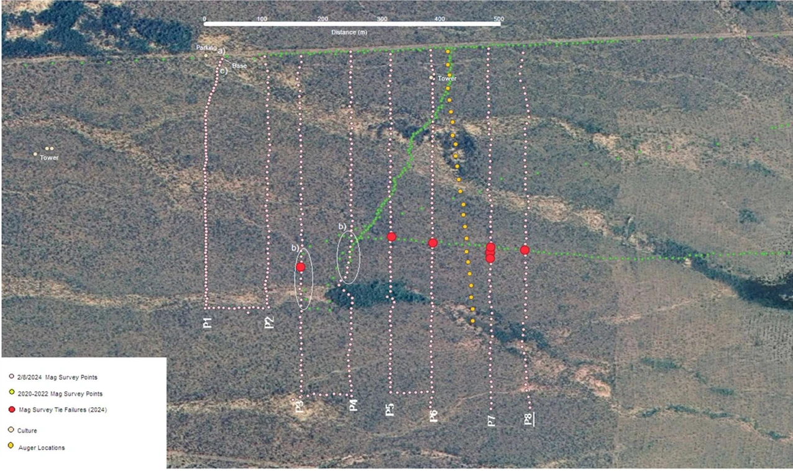
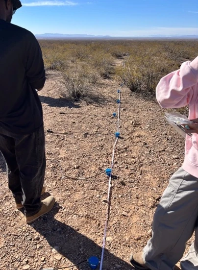
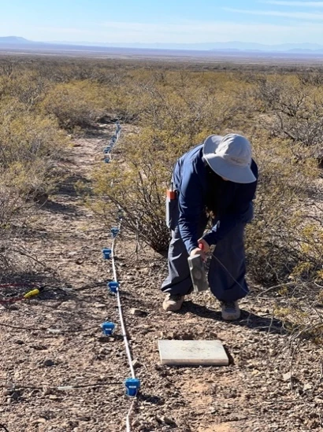
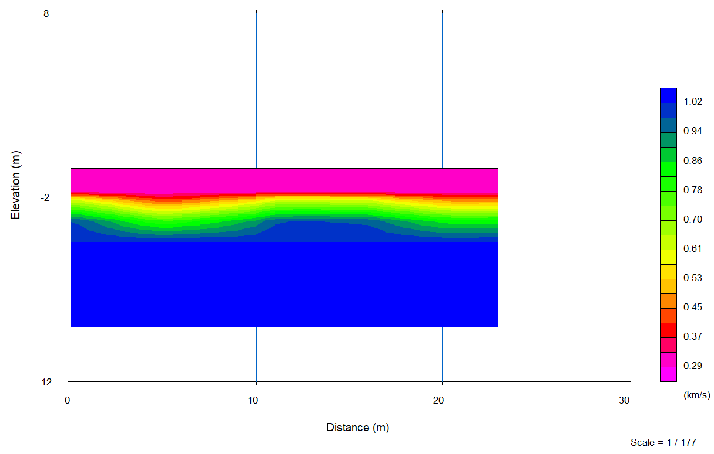
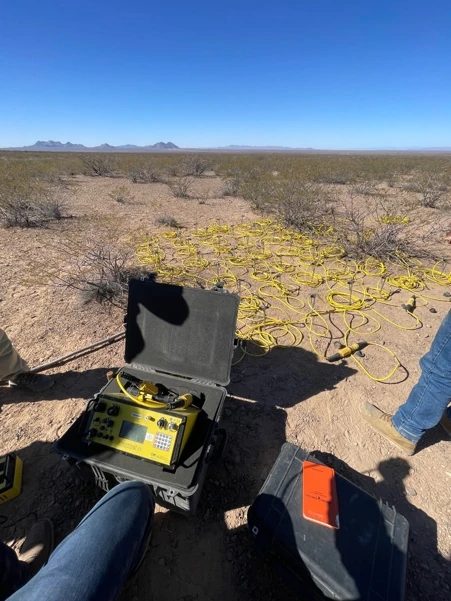
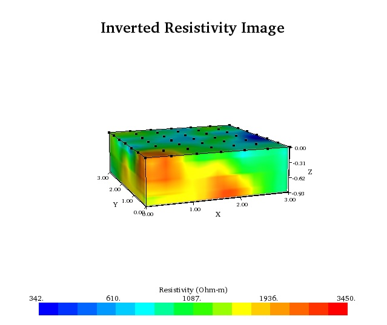
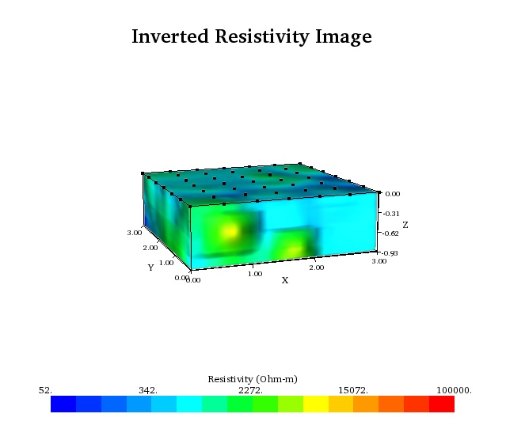
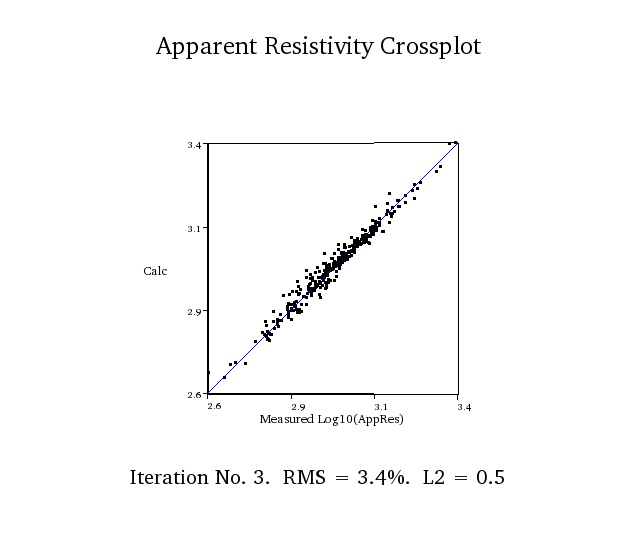
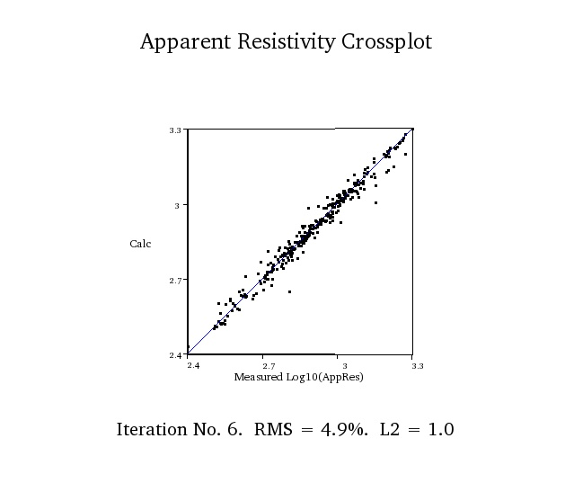

At the Jornada Experimental Range near Las Cruces, New Mexico, the surface gave us a starting point: scattered shrubs, loose sandy sediment, small arroyos, and the San Andres Mountains behind our survey lines. Our question lay below that surface. How could we use geophysics to investigate the material beneath our feet and its response to water?

Over three days, our Field II class worked with seismic refraction, electrical resistivity, and GPS. We set out instruments, collected measurements, and turned the recordings into models of the shallow subsurface. The project connected the practical work of a field survey with a harder task: deciding what the resulting images could tell us about water in a dry landscape.

## A survey on the piedmont

Our study area was the Piedmont site, a gently sloping surface west of the San Andres Mountains. Small channels cut through sandy and gravelly ground between patches of vegetation. We also examined desert pavement and exposures identified during the trip as part of the Camp Rice Formation. These observations gave us a geological setting for interpreting the measurements.

The class built on earlier work associated with Dr. Diane Doser, adding observations in areas that had not been covered during previous surveys. GPS work helped us relate positions on the ground to the broader landscape. The site image below records earlier survey lines; it provides context for the field exercise rather than a map of every measurement collected on our trip.

*Figure 1. Earlier survey lines at the Piedmont site, reproduced from the report, which credits the previous surveys to Dr. Diane Doser.*

We expected relatively continuous sandy material beneath the seismic line. For the electrical survey, we expected dry ground to be resistive and wondered whether wetter areas would respond differently. These were working hypotheses to compare with the observations, not conclusions that could be drawn from vegetation alone.

## Building the seismic line

Our group laid out a measuring tape along an approximately 24-metre line and placed 24 geophones at one-metre intervals. Each geophone needed to sit upright and make good contact with the ground. Cables connected the receivers to a recording unit, computer, and external battery.

We generated seismic waves by striking a metal plate with a hammer fitted with a trigger sensor. At each source position, we recorded three strikes, pausing between them so the system could capture each event. Calling “quiet on the line” helped limit interference from people moving nearby. Setting up the equipment carefully was as much a part of the measurement as the hammer strike itself.

*Figures 2–3. Receivers along the seismic line and the hammer-and-plate source used to generate waves. Field photographs from the report.*

Back at the computer, we used Pickwin to identify the first arrival of the seismic signal at each receiver. We then brought those travel-time picks into PlotRefa to develop a velocity model. This processing step turns observations of when a wave arrives into an interpretation of how quickly it travels through the ground.

## Reading the velocity section

The final section shows a relatively slow near-surface zone above faster material. Its bands vary gently along the line, without an obvious abrupt lateral break in the displayed model. That pattern was broadly consistent with our expectation of a continuous sedimentary setting, although the model does show a substantial change in velocity vertically.

*Figure 4. The processed seismic section. Colors represent modeled velocity in kilometres per second, not named rock types; the vertical axis is labeled elevation in metres.*

The figure is a velocity model, not a direct photograph of sediment layers. Surface observations help interpret it, but its colors alone cannot establish a particular lithology or locate the water table. Nor does the bottom of the plotted model, by itself, establish how well the deepest material was resolved. Keeping those distinctions clear makes the section useful without asking it to answer more than the survey supports.

## Adding water to the electrical survey

The resistivity exercise focused on a much smaller area. The report describes a three-by-three-metre plot with a seven-by-seven grid at half-metre spacing. Electrodes connected to a SuperSting system allowed us to inject current and record voltage differences across the ground. We compared measurements made before and after water was added with a hose.

*Figure 5. Equipment and electrode cables for the resistivity survey.*

Electrical resistivity describes how strongly material opposes electrical current. In shallow ground, water in pore spaces and its dissolved salts can strongly affect the measurement. Clay content, porosity, and other material properties also matter, so a resistivity value does not uniquely identify either moisture content or rock type. The [U.S. EPA’s overview of electrical methods](https://www.epa.gov/environmental-geophysics/electrical-methods) explains these overlapping influences.

The two model images show how the interpreted electrical structure differed between the runs. The report interpreted the response after watering as evidence of wetting within the shallow sediment. A careful comparison, however, needs the numerical legends as well as the colors.

*Figure 6. Before water was added. The displayed scale spans 342–3,450 Ω·m.*

*Figure 7. After water was added. The displayed scale spans 52–100,000 Ω·m.*

The figures use different color scales. The same color therefore does not represent the same resistivity in both images. Their appearance alone cannot quantify a change; a numerical comparison or a shared scale would be needed. The displayed vertical coordinate reaches approximately −0.93 m, so these images describe a shallow volume.

## Checking how the models fit

The apparent-resistivity crossplots compare measurements with values calculated from the models. Points near the diagonal indicate closer agreement. In these plots, “Calc” means calculated apparent resistivity. The [EarthImager 3D manual](https://arf.berkeley.edu/files/attachments/equipment/EarthImager3DManual.pdf) identifies this display as a data-misfit crossplot.

*Figure 8. Before watering: iteration 3, reported RMS misfit 3.4%.*

*Figure 9. After watering: iteration 6, reported RMS misfit 4.9%.*

The reported RMS misfit increased from 3.4% to 4.9%, and the second plot shows more scatter around the diagonal. These are checks on how well the models reproduce the electrical measurements. They are not measurements of calcite concentration or evidence that a carbonate layer spread during the experiment. A close fit also does not, on its own, establish a unique geological interpretation.

## What the fieldwork tells us

Together, the surveys gave us complementary views of the site: seismic travel times constrained a model of shallow velocity structure, while the electrical experiment investigated the ground’s response to added water. GPS positions and field observations connected that work to the terrain we could see.

The report proposed caliche, a carbonate-cemented horizon, as a possible influence on water movement. That remains a hypothesis for further investigation here. The shallow electrical images do not establish the presence or depth of a deeper barrier, and this short exercise did not measure groundwater recharge or seasonal changes in the water table.

For me, the value of the trip was learning how much care sits between a field observation and a finished interpretation. We leveled receivers, checked connections, repeated hammer strikes, and picked arrivals before reading a model. At Jornada, understanding water below a dry surface begins with those measurements—and with knowing which questions still need more evidence.

## Sources

This essay is adapted from my *Jornada Final Report* for the 2025 Field II trip. The field photographs, site image, and model outputs are reproduced from that report. Data collection and processing were part of a collaborative class exercise. The original plot scales and labels are retained so the results can be read in context.

**Background cited in the report** 
Doser, D. I., & Baker, M. R. (2021). Geophysical reconnaissance for siting dryland critical-zone monitoring experiments in southern New Mexico, USA. *Journal of Environmental and Engineering Geophysics, 26*, 255–266. [doi:10.32389/JEEG21-022](https://doi.org/10.32389/JEEG21-022). 
Karplus, M., & Chapman, J. (2025). *Trip I: Geophysics at Jornada Experimental Range*. Course field-trip material.

**Methods and figure interpretation** 
U.S. Environmental Protection Agency. [Electrical methods](https://www.epa.gov/environmental-geophysics/electrical-methods). 
Advanced Geosciences, Inc. (2007). [EarthImager 3D instruction manual](https://arf.berkeley.edu/files/attachments/equipment/EarthImager3DManual.pdf), version 1.4.1, section 3.8.5.

