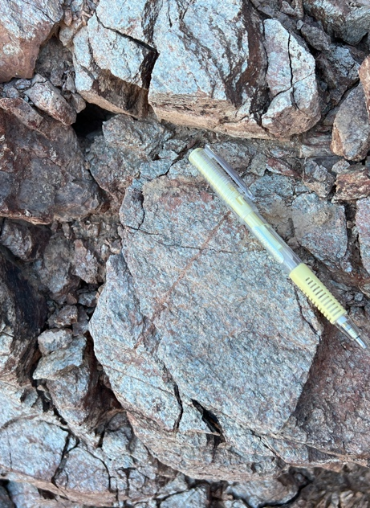
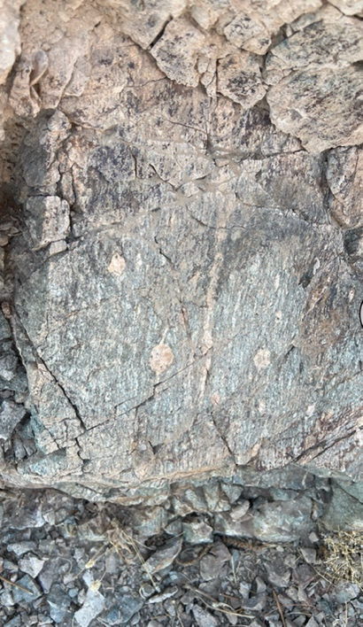
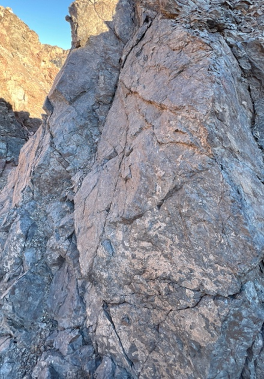
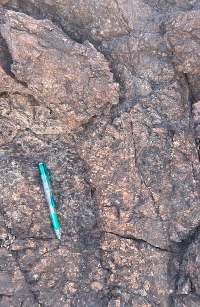
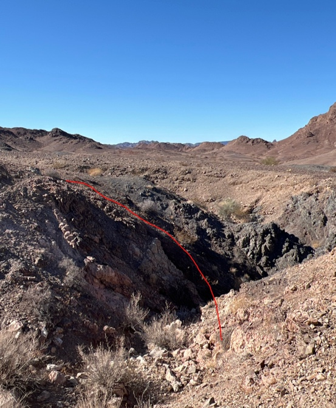
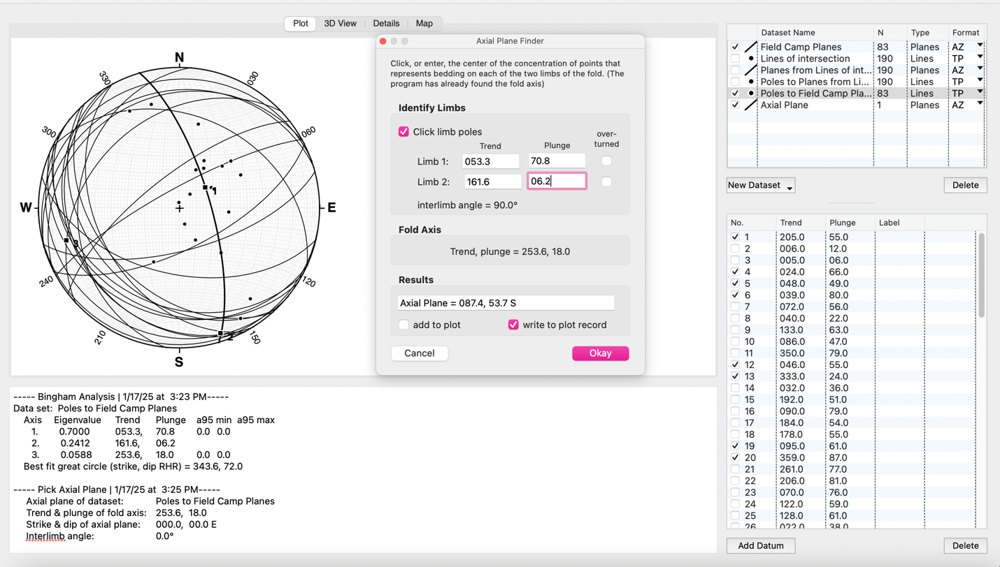

At Picacho Peak in southeastern California, tracing a rock unit across a hillside often meant following it toward a fault. Over four days of fieldwork near Winterhaven, our mapping connected three contrasting rock packages: the Orocopia Schist, orthogneiss, and the Winterhaven Formation. Their contacts and changing orientations helped us interpret a landscape shaped by fault movement and folding.

The work moved between individual exposures and the larger map. We recorded mineral textures, bedding, foliation, and fractured zones, then compared those observations across steep hills and valleys partly covered by loose alluvium. StraboSpot organized the field observations, while a stereonet helped us examine the pattern of measured orientations.

## The field map

The map brings together unit boundaries, fault traces, observation points, and structural measurements. Blue marks the Orocopia Schist, green marks orthogneiss, and purple marks the Winterhaven Formation. These colors identify rock units; they do not represent an oldest-to-youngest sequence.

*Figure 1. Geological field map of the Picacho Peak study area. Select the map to enlarge it.*

The numbered observations and structural symbols connect the colored areas to measurements collected on the ground. Our field notes also record exposures of schist, metaconglomerate, limestone, and breccia. Between those locations, tracing a contact required comparing neighboring outcrops and considering where sediment concealed the bedrock.

## Recognizing the rocks

### Orocopia Schist

The schist was generally green-gray, with a strong planar fabric and visibly aligned minerals. Our field descriptions recorded mica minerals including muscovite and biotite, together with chlorite. Foliation gave the rock a repeated internal orientation, and mineral lineation supplied another feature to measure.

Recognizing that fabric mattered because it could be followed from one exposure to another. It also needed to be distinguished from sedimentary bedding: a metamorphic foliation records mineral alignment during deformation and recrystallization, rather than simply the original layering of a deposit.

### Orthogneiss

The orthogneiss was heavily weathered and fractured, with surfaces ranging from muddy brown to reddish orange. Alternating dark and light bands were approximately half an inch to two inches wide in the exposures described in the report. Darker, mafic bands were more prominent, while the lighter bands were feldspar-rich.

We also identified feldspar-rich features interpreted in the field as sigma-type structures. These helped draw attention to deformation within the rock, although a reliable shear-sense interpretation would require an appropriately oriented view and comparison with other indicators. The banding and mineral composition provided practical ways to distinguish the gneiss from the neighboring schist.

*Figures 2–3. Orocopia Schist and orthogneiss photographed during the field project.*

### Winterhaven Formation

The Winterhaven exposures included both metasedimentary and metavolcanic rocks. The metasedimentary group contained limestone and metaconglomerate, with bedding visible in some exposures. Reddish and purplish colors, angular surfaces, and abundant fractures were recurring features in the field descriptions.

A hand sample reacted to acid, consistent with carbonate material, and some surfaces preserved slickenlines. These linear marks were useful evidence of slip on particular surfaces. They did not, by themselves, establish the movement history of an entire mapped fault.

The metavolcanic material was described as fine-grained and blue-gray, without obvious bedding. Quartz veins ranged from about an inch to a foot in width. Together, these observations showed why the Winterhaven needed to be understood as a varied rock package rather than identified by a single color or texture.

*Figures 4–5. Limestone and metaconglomerate identified in the Winterhaven Formation.*

## Following the fault contacts

The field report identifies the Gatuna and Chocolate Mountains faults as the principal structures separating the rock packages. We followed contacts and looked for changes in texture, orientation, and degree of fracturing. Brecciated zones—rock broken into angular fragments—were particularly conspicuous near some of the contacts.

Where the units approached one another, the arrangement could change over a short distance. Mapping those transitions helped us distinguish a boundary between rock types from an isolated weathered surface. The combination of a contact, disrupted rock, and nearby structural measurements provided a stronger interpretation than any one feature alone.

*Figure 6. The annotated fault-zone photograph from the report. Its red line marks the interpreted contact.*

The regional relationships provide useful context for those observations. [Oyarzabal and colleagues (1997)](https://pubs.usgs.gov/publication/70019647) describe the Chocolate Mountains fault above the Orocopia Schist and the Gatuna fault separating upper-plate gneisses from the Winterhaven Formation. Their work connects these structures with exhumation and extension. The fault names used here follow the field report and that regional terminology.

## Finding the fold

The measured orientations suggested an antiform: an upward-arching fold shape with surfaces dipping away from its central region. Foliation in the schist also changed orientation across the mapped area, helping us compare the fabric within the rocks with the broader pattern on the map.

I use *antiform* to describe that geometry without assuming that the oldest rocks occupy its center. In a faulted metamorphic terrain, structural position and rock age need to be evaluated separately.

The stereonet analysis recorded a fold-axis trend of **253.6°** and a plunge of **18.0°**, indicating an axis plunging gently toward the west-southwest. These values summarize the orientation dataset used for the project; they do not imply that every exposure follows an identical fold geometry.

*Figure 7. The stereonet analysis used to examine the fold. The reported fold-axis result is visible in the central panel.*

The field observations and stereonet were most useful together. Outward dips suggested the fold shape, while the plotted measurements provided a way to compare orientations that were difficult to visualize from separate hillsides. Neither the map pattern nor the stereonet alone dated the folding.

## Placing the observations in time

The project brought together rocks with different origins and a history involving more than one episode of deformation. The schist preserves metamorphic mineral fabrics; the orthogneiss records an igneous precursor modified by deformation; and the Winterhaven includes sedimentary and volcanic material. Their present arrangement reflects later structural movement as well as their earlier formation.

Regional research by [Ricketts and colleagues (2011)](https://doi.org/10.2110/jsr.2011.66) describes episodic growth of the Chocolate Mountains anticlinorium following an earlier period of extension. That broader history helps explain why the structures should not all be assigned to one event. The order of units across a fault is also not a simple stratigraphic age sequence.

For me, the value of the project was in connecting observations across scales. Mineral alignment helped identify a fabric, fractured contacts helped trace structures, and measurements from separate outcrops revealed a larger fold. Repeatedly moving between the ground, the map, and the stereonet made the geological interpretation more coherent while keeping the evidence for each part visible.

## Sources

Adapted from my *Picacho Peak Project Report* and its accompanying *Picacho Project 2* field map. The photographs, local rock descriptions, structural observations, and stereonet come from the report. Regional context is identified separately in the text.

**Regional interpretation** 
Oyarzabal, F. R., Jacobson, C. E., & Haxel, G. B. (1997). Extensional reactivation of the Chocolate Mountains subduction thrust in the Gavilan Hills of southeastern California. *Tectonics, 16*(4), 650–661. [USGS publication record](https://pubs.usgs.gov/publication/70019647). 
Ricketts, J. W., Girty, G. H., Sainsbury, J. S., Muela, K. K., Sutton, L. A., Biggs, M. A., & Voyles, E. M. (2011). Episodic growth of the Chocolate Mountains anticlinorium recorded by the Neogene Bear Canyon Conglomerate, southeastern California, U.S.A. *Journal of Sedimentary Research, 81*(12), 859–873. [doi:10.2110/jsr.2011.66](https://doi.org/10.2110/jsr.2011.66).

**Map reference cited in the field report** 
Richard, S. M., & Spencer, J. E. (1996). *Geologic map of the Picacho Mine area, southeastern California*. Arizona Geological Survey, Open-File Report 96-30, scale 1:10,000.

