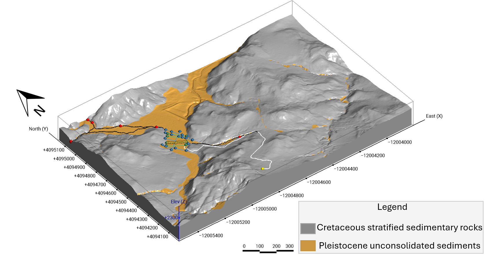
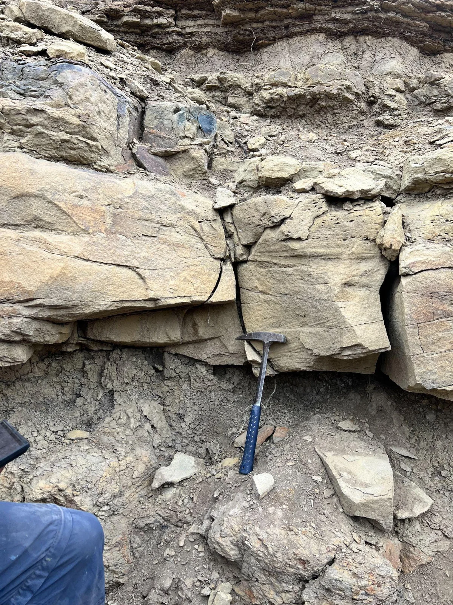
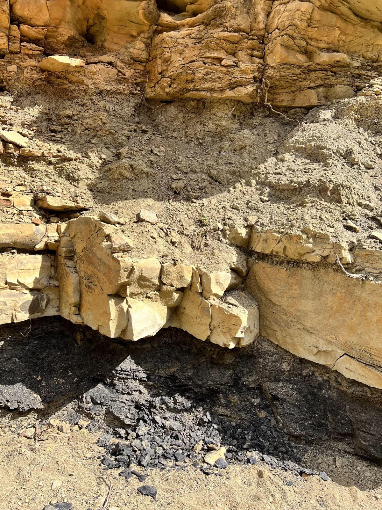
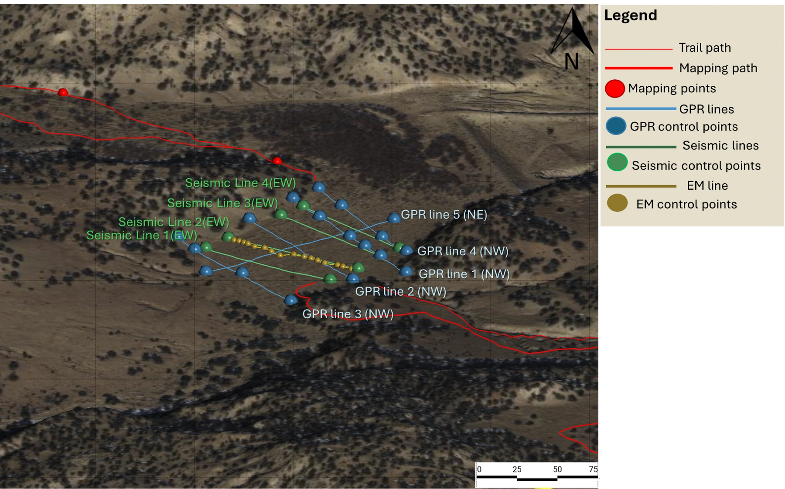
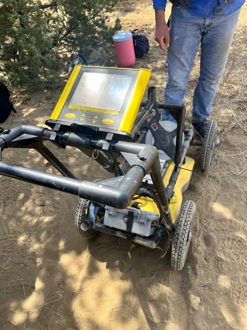
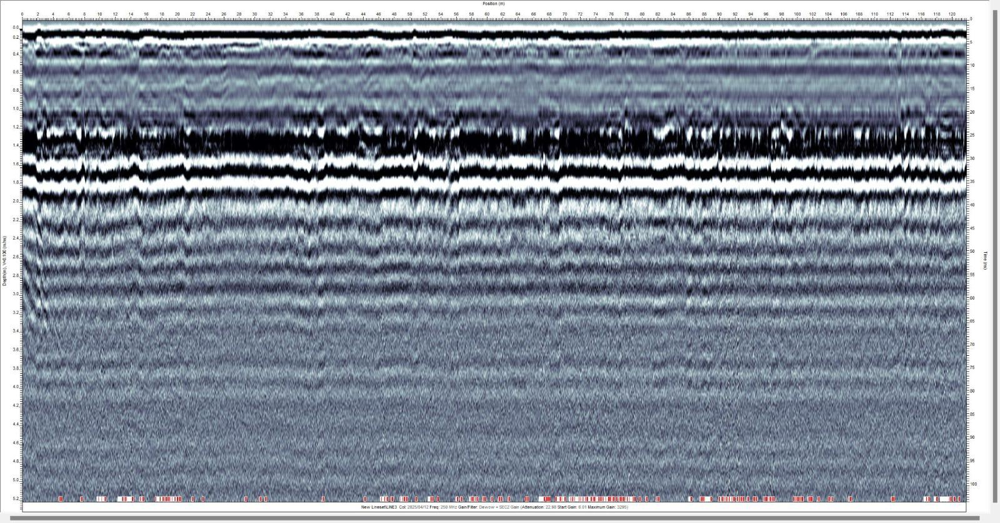
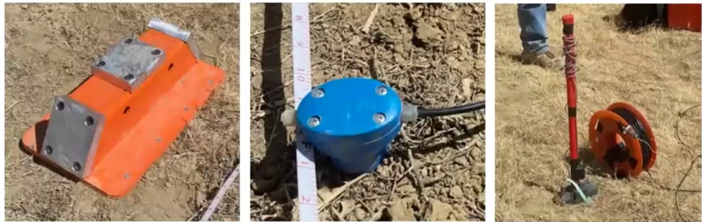

At Reynolds Field Station, a flat field surrounded by low hills became the focus of a question about an older landscape. Could the sediment beneath the field occupy a former valley? Over three days, our Field II class combined observations of nearby outcrops with geophysical surveys to investigate that possibility.

The work brought together two ways of reading the ground. In the ravines, we could examine sandstone, fine-grained beds, plant fossils, and a dark coal layer directly. Across the field, ground-penetrating radar and active-source seismic surveys gave us records of the shallow subsurface. Comparing those observations helped us develop an interpretation of sediment filling the valley while identifying what remained uncertain.

## A landscape with an older shoreline

[Reynolds Field Station](https://reynoldsfieldstation.org/about-us/) lies north of Datil in Catron County, New Mexico. The station describes its exposed coastal-plain deposits as approximately 84–89 million years old, part of the Late Cretaceous Crevasse Canyon Formation along the former western margin of the Western Interior Seaway. These rocks preserve a setting very different from the field and wooded hills we walked through.

The geological map included in our report distinguishes the older stratified rocks from unconsolidated sediment along the valley. Its legend labels the younger material as Pleistocene. That mapped age assignment provides context; it was not an age measured by our radar or seismic surveys.

*Figure 1. The geological setting reproduced from the report. Gray denotes Cretaceous stratified sedimentary rocks; ochre denotes material labeled Pleistocene unconsolidated sediments in the original legend.*

## What the outcrops preserved

Along the dry drainage walls, two contrasting types of beds stood out. Gray, fine-grained material was crumbly and lacked the obvious internal structures seen in the adjacent sandstone. The tan sandstone was coarser and generally more resistant. Some sandstone bodies thickened toward their centers and thinned toward their edges, a shape we interpreted as consistent with channel deposits.

We recorded trough cross-bedding, ripple cross-stratification, and thin laminations. The report also describes mud remnants interpreted as rip-up material, fossilized wood, and plant impressions identified in the field as palm fronds and small leaves. Together, these observations suggested changing flow conditions and the preservation of vegetation within the sedimentary succession.

*Figures 2–3. Contrasting sandstone and fine-grained beds, and a dark layer identified during the fieldwork as lignite. Photographs reproduced from the report.*

The lignite occurred as a soft, dark, crumbly bed that we estimated to range from roughly eight inches to two feet thick at the observed exposure. Its presence contributed to our interpretation of an interval of wetland conditions. The broader succession suggested channels, floodplains, and areas where organic material could accumulate.

We also noted flaser bedding: rippled sand with discontinuous mud layers. This structure records alternating depositional conditions, but it is not unique to a tidal setting. [Martin’s study of flaser and wavy bedding](https://doi.org/10.1016/S0037-0738(00)00085-3), cited in the original report, documents examples in ephemeral streams. The surrounding beds and fossils therefore mattered as much as any single sedimentary structure.

## Laying out the surveys

Our geophysical work focused on the relatively flat field between the hills. The class collected several kinds of measurements; this essay follows the radar and active-source seismic work described in my report. GPS positions and survey markers connected the measurements to their locations on the ground.

*Figure 4. Survey layout from the class project, including the GPR and seismic lines discussed here. The original map also records electromagnetic survey locations and the mapping route.*

For GPR, our team laid out four approximately parallel lines running northwest, each planned to extend about 140 metres, with roughly 50 metres between lines. A fifth line crossed them toward the northeast over about 180 metres. The crossing line gave us another direction from which to examine the field.

The Noggin SmartCart had to stay close to the ground as it moved along each transect. Bushes, thick grass, and uneven patches made that less straightforward than a straight line on a map. We tried to maintain the intended path while keeping the cart in contact with the surface.

*Figure 5. The ground-penetrating radar cart used during the survey.*

GPR transmits electromagnetic pulses and records returning energy where subsurface electrical properties contrast. We processed the recordings in EKKO Project, using GPS information and applying time-zero correction, background removal, gain adjustment, and depth conversion. These steps made the profiles easier to examine, while the conversion from travel time to depth still depended on an assumed radar velocity.

## Reading the radar profile

The example below is survey line 3. It contains strong, broadly continuous bands in its upper portion, with local disruptions and less distinct texture below. The displayed segment extends to approximately 120 metres along the horizontal axis. Its depth axis uses a radar velocity of 0.10 metres per nanosecond.

*Figure 6. The processed radar profile reproduced from the report. The depth scale is a conversion from travel time using the velocity printed on the figure.*

In the field report, we considered vegetation, uneven ground, and nearby rocks as possible explanations for some of the disturbances. Those are interpretations rather than identified buried objects. A strong shallow band can also include direct-wave or ground-coupling effects, while a relatively uniform deeper response can reflect weak contrasts or signal attenuation. The [U.S. EPA’s GPR overview](https://www.epa.gov/environmental-geophysics/ground-penetrating-radar-gpr) explains these limitations. The profile alone does not establish that deeper sediment is more compacted.

## Recording seismic arrivals

The seismic setup used 24 geophones, cables, a recording computer, an external battery, a sledgehammer, and an experimental strike plate. We checked the receivers with a bubble level and used a hammer sensor to trigger the recording when the source was struck.

*Figure 7. Seismic equipment from left to right: strike plate, geophone, and sledgehammer.*

The plate had a horizontal top and inclined side faces intended to help generate different wave motions. At successive positions between receivers, we recorded two strikes on top and one on a side. The class collected four parallel seismic lines, moving the equipment between surveys. People walking nearby and other survey activity could introduce noise, making coordination important.

We picked first arrivals in Pickwin and used PlotRefa to develop a travel-time model. With 24 receivers spaced four metres apart, there are 23 intervals, spanning 92 metres. This agrees with the horizontal extent of the model below.

## Interpreting the velocity model

The displayed model contains a thin, slower zone near the surface above a faster, comparatively uniform region. The shallow bands dip locally around the middle of the line. The color legend spans approximately 0.27–0.47 kilometres per second, and the model domain extends to about −32 metres on an elevation axis referenced near zero at the surface.

*Figure 8. The seismic model from the report. Colors show modeled velocity; the smooth model’s numerical layers are not a count of observed geological beds.*

We interpreted the low velocities in the context of loose sediment observed at the surface. A comparison with material-velocity tables would also need the wave type and acquisition details to be established. As the [EPA’s seismic-velocity guidance](https://www.epa.gov/environmental-geophysics/seismic-velocities) explains, velocity depends on elastic properties and density, and P and S waves travel differently. A color band cannot be assigned to sandstone solely from its speed.

The plotted depth is the extent of the model, not proof that every part of that depth range is equally resolved. The smooth appearance and local dips are useful observations, but the figure does not independently trace a buried valley floor or determine the age of its fill.

## Bringing the evidence together

Our working interpretation was that the field contains sediment associated with an older valley. The surrounding terrain, mapped unconsolidated material, and geophysical responses made that interpretation plausible. The exposed sandstone, fine-grained beds, plant remains, and lignite supplied a separate record of the much older depositional environments preserved in the bedrock.

Keeping those histories distinct matters. The Cretaceous outcrops help explain the geological setting, but they do not directly date the younger sediment beneath the field. Likewise, the radar and seismic images add information about subsurface properties without uniquely confirming the shape or age of a paleovalley.

The project gave us a basis for comparing neighboring survey lines and choosing where additional observations would be most useful. For me, its lasting lesson was the value of moving between an outcrop and a model: examining what the rock preserves, checking how the instruments responded, and using each to guide the next question.

## Sources

Adapted from my *Reynolds Field Station Geophysical Research Project* report for Field II at The University of Texas at El Paso. The photographs, maps, equipment images, and processed profiles are reproduced from the report. Survey collection and processing were part of the collaborative class project.

**Setting and sedimentary interpretation** 
Reynolds Field Station. [About us and geological setting](https://reynoldsfieldstation.org/about-us/). 
Martin, A. J. (2000). Flaser and wavy bedding in ephemeral streams: A modern and an ancient example. *Sedimentary Geology, 136*(1–2), 1–5. [doi:10.1016/S0037-0738(00)00085-3](https://doi.org/10.1016/S0037-0738(00)00085-3).

**Geophysical methods** 
U.S. Environmental Protection Agency. [Ground-penetrating radar](https://www.epa.gov/environmental-geophysics/ground-penetrating-radar-gpr) and [seismic velocities](https://www.epa.gov/environmental-geophysics/seismic-velocities). 
Geometrics. [Hammer switch vs trigger geophone](https://www.geometrics.com/support/hammer-switch-vs-trigger-geophone/).

